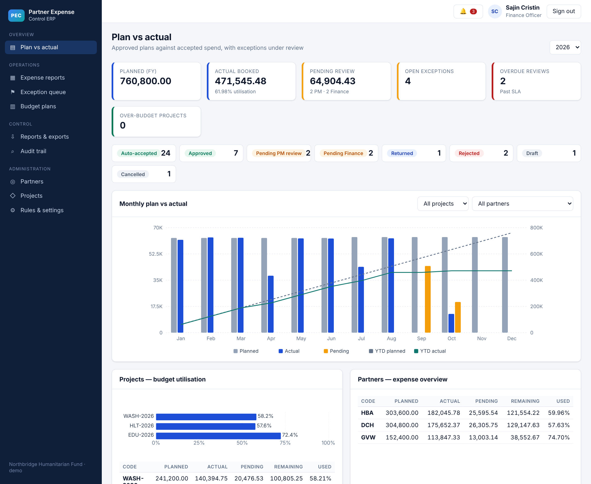
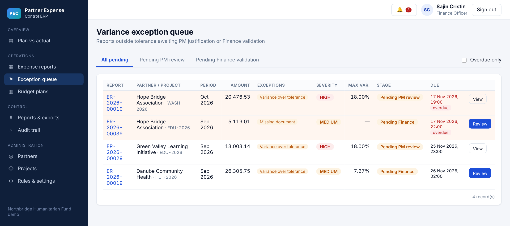
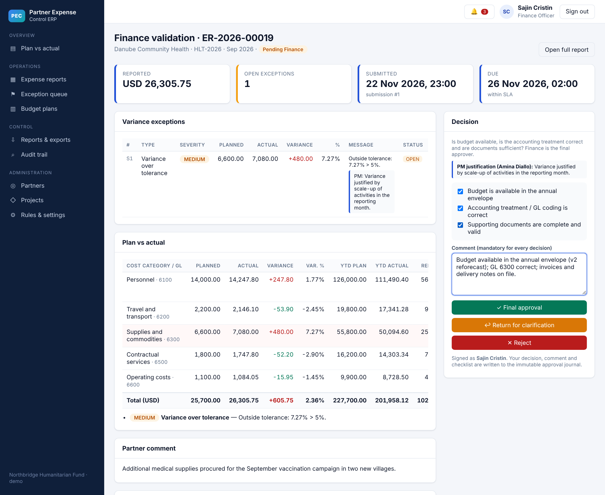
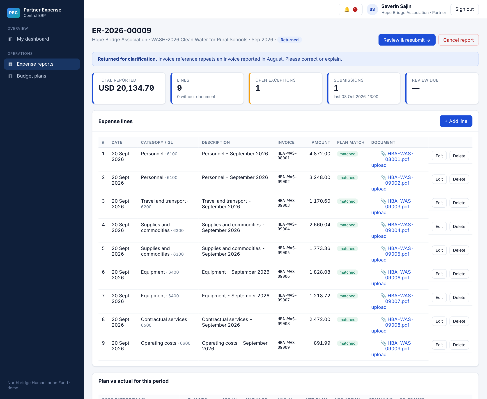
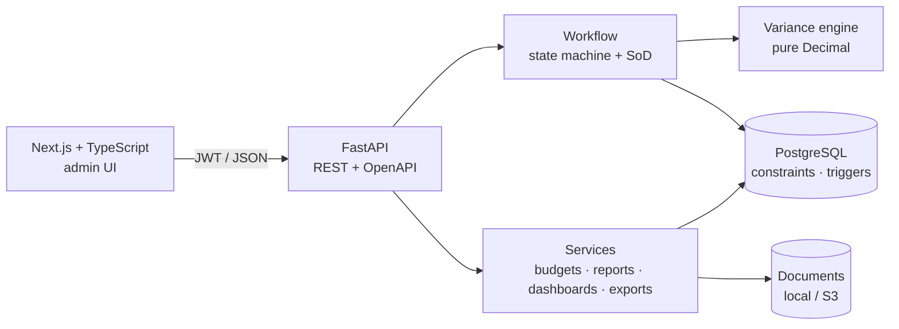

# Partner Expense Control ERP
### Plan vs Actual Monitoring and Variance Approval System

[](.github/workflows/ci.yml)
 
 


An ERP-style financial control module for organisations that implement projects through external partners.
Partners report monthly expenses; the system compares every line with the approved budget, **auto-accepts what is
within policy**, and routes only the **exceptions** through a two-level review — Project Manager, then Finance — with
segregation of duties and a tamper-proof audit trail.

> Portfolio project. Organisation, partners, projects and people in the demo data are fictional.

---

## The business problem

A grant-funded organisation works with many implementing partners. Each month every partner sends an expense report
per project. Finance has to answer, for every line: *Was this planned? Is the overspend acceptable? Is the invoice
real and not reported twice? Who accepted it, and why?*

Done in spreadsheets and e-mail this is slow (every report is reviewed in full), inconsistent (thresholds live in
people's heads), and weak on control (no reliable record of who approved what, or of changes after approval).

## The solution

| Step | What happens |
|---|---|
| **Plan** | Finance loads the approved budget per partner × project × month × cost category × GL account. Changes create a new **version**, activated under **maker-checker**. |
| **Report** | Partners enter lines with invoice references and supporting documents, and see a live plan-vs-actual preview before submitting. |
| **Control** | On submission the **variance engine** calculates planned, actual, variance, %, YTD and remaining budget, applies **configurable tolerance rules**, and checks for duplicate invoices, unplanned spending, missing documents and annual overruns. |
| **Decide** | No exception → **AUTO_ACCEPTED**. Otherwise the report goes to the **assigned PM** (business justification) and then **Finance** (budget, accounting treatment, documents — final approver). Approve / reject / return, comment mandatory. |
| **Oversee** | Dashboards, exception queue with SLA, monthly variance report, Excel/CSV exports, field-level audit trail. |

## Key features

- **Variance engine** in pure Python `Decimal` — deterministic, unit-tested, explainable (calculation snapshot stored with every exception).
- **Rules as data**: max % *and* max amount, scope (project / partner / cost category / global), direction (overspend only or both), priority, validity dates, *most-specific-wins*, **fail-safe** when no rule applies.
- **Five automated controls**: tolerance breach, no plan line, duplicate invoice, missing document (block or review — configurable), annual budget overrun.
- **Explicit state machine** (9 statuses, 12 transitions) — one source of truth for code, tests and documentation.
- **Segregation of duties** in three layers: API role guards, workflow guards (four-eyes, assigned PM only, no self-review, conflicting role sets refused), and **database constraints/triggers**.
- **Audit trail**: automatic old/new values for every change of financial data, business events with comments, append-only at database level.
- **Budget versioning** with mandatory change reason, CSV upload (all-or-nothing validation) and maker-checker activation.
- **Dashboards & reports**: KPIs, monthly plan vs actual with YTD, project/partner utilisation, top variances, PM/Finance queues, overdue items, Excel/CSV exports.
- **Production-minded**: Alembic migrations, OpenAPI docs, consistent error envelope, pagination/filtering/sorting, request ids, Docker Compose, GitHub Actions.

## Screenshots

| | |
|---|---|
|  |  |
|  |  |


## Architecture



Details: [docs/architecture.md](docs/architecture.md) · rules: [docs/business-rules.md](docs/business-rules.md) ·
data model: [docs/erd.md](docs/erd.md) · API: [docs/api.md](docs/api.md) · stories: [docs/user-stories.md](docs/user-stories.md) ·
plan: [docs/project-plan.md](docs/project-plan.md)

## Tech stack

| Layer | Technology |
|---|---|
| Backend | Python 3.12, FastAPI, SQLAlchemy 2.0, Alembic, Pydantic v2, PyJWT, bcrypt, openpyxl |
| Database | PostgreSQL 16 (NUMERIC money, native enums, partial unique indexes, JSONB, triggers) |
| Frontend | Next.js 14 (pages router), React 18, TypeScript (strict), Recharts |
| Quality | Pytest (unit + API integration), Ruff, TypeScript type-check |
| Delivery | Docker, Docker Compose, GitHub Actions |

## Getting started

### Option A — Docker (recommended)

```bash
git clone https://github.com/sajincris/partner_expense_control.git
cd partner_expense_control
docker compose up --build
```

| Service | URL |
|---|---|
| Web UI | http://localhost:3000 |
| API docs (Swagger) | http://localhost:8000/docs |
| ReDoc | http://localhost:8000/redoc |

The backend container runs `alembic upgrade head`, seeds the demo data (idempotent) and starts the API.
Reset everything with `docker compose down -v`.

### Option B — local development

```bash
# Database
docker compose up -d db

# Backend
cd backend
python -m venv .venv && source .venv/bin/activate      # Windows: .venv\Scripts\activate
pip install -r requirements-dev.txt
cp .env.example .env
alembic upgrade head
python -m app.seed
uvicorn app.main:app --reload

# Frontend (second terminal)
cd frontend
cp .env.example .env.local
npm install
npm run dev
```

### Tests

```bash
cd backend
pytest -q                 # unit (engine, state machine) + API integration tests
ruff check app tests
cd ../frontend && npm run typecheck
```

## Demo credentials

All demo users share the password **`Demo@2026!`** (demo only — never reuse).

| Role | Email | What to try |
|---|---|---|
| Partner — Hope Bridge Association | `partner.hba@demo.local` | Open the **returned** September WASH report, fix the duplicate invoice, resubmit |
| Partner — Danube Community Health | `partner.dch@demo.local` | Finish the October **draft**, preview the variance, submit |
| Partner — Green Valley Learning | `partner.gvw@demo.local` | Follow a report under review |
| Project Manager (WASH, EDU) | `pm.wash@demo.local` | Review the **overdue** WASH exception and the pending EDU one |
| Project Manager (Health) | `pm.health@demo.local` | See the strict payroll rule at work (approved in February) |
| Finance Officer | `finance@demo.local` | Validate items in the Finance queue (checklist + comment) |
| Finance Officer 2 | `finance2@demo.local` | Second approver for four-eyes demos |
| Finance Lead / Administrator | `admin@demo.local` | Edit tolerance rules, settings, periods, users; activate budget versions |
| Auditor | `auditor@demo.local` | Read-only: dashboards, exports, audit trail |

**Seeded scenario (FY 2026):** 3 partners, 3 projects, 4 partner–project budgets (one with a reforecast v2),
3 tolerance rules, 40 monthly reports covering every status — auto-accepted, approved after PM + Finance,
rejected by PM, rejected by Finance, returned, returned → resubmitted → approved, pending PM (one overdue),
pending Finance (one overdue), draft and cancelled — with duplicate-invoice, no-plan-line and missing-document cases.

## API documentation

Swagger UI at `/docs`: click **Authorize** and log in with a demo e-mail as *username*. Every endpoint documents
its request/response schema, required role and error codes. A curated reference with examples is in
[docs/api.md](docs/api.md).

## ERP competencies demonstrated

| Competency | Where to look |
|---|---|
| Financial controls design (tolerances, four-eyes, maker-checker, fail-safe) | `docs/business-rules.md`, `app/workflows/` |
| Workflow automation & exception management | State machine, auto-acceptance, exception queue with SLA |
| Role-based approvals and segregation of duties | `app/core/deps.py`, `report_workflow.py`, `user_service.py`, DB constraints |
| Auditability and data integrity | Audit listener, append-only triggers, DECIMAL money, CHECK/partial-unique constraints |
| Master data & chart of accounts | Partners, projects, agreements, cost categories ↔ GL accounts, fiscal calendar |
| Budgeting & reforecasting | Versioned plans, CSV upload, activation workflow |
| Reporting & analytics | Plan vs actual, YTD, utilisation, top variances, Excel exports |
| Solution architecture | Layered modular monolith, pure domain core, storage abstraction, stateless API |
| Delivery practices | Migrations, tests, CI with DB-control verification, containers, documentation |
| Business ↔ technical translation | Design decisions explained in both terms (`docs/architecture.md` §5) |

## Roadmap

| Horizon | Item |
|---|---|
| Next | Multi-currency reporting with dated FX revaluation · e-mail/Slack notifications · approval delegation & out-of-office · httpOnly refresh tokens, SSO (OIDC / Entra ID) |
| Mid | Budget reforecasting workspace with what-if · purchase orders & commitments (plan → commitment → actual) · invoice matching (2/3-way) · payment status tracking |
| Later | Accounting-system integration (journal export / API to Dynamics, SAP B1, Odoo) · Power BI / Metabase semantic layer · mobile-friendly partner portal with offline capture · AI-assisted variance explanation drafts for partners and reviewers · advanced reconciliation reports (bank, advances, partner ledgers) |

## Project structure

```
backend/   FastAPI app (api, core, models, schemas, services, workflows, utils), alembic, tests
frontend/  Next.js app (pages, components, services, hooks, context, types, styles)
docs/      architecture, business rules, ERD, API, user stories, project plan
```

## Commit convention

Conventional Commits — `feat(engine): …`, `feat(workflow): …`, `fix(api): …`, `test: …`, `docs: …`, `ci: …`.

## License

MIT — see [LICENSE](LICENSE).
