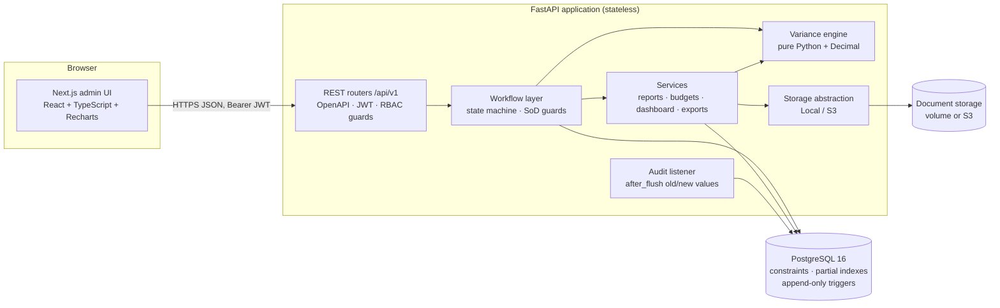
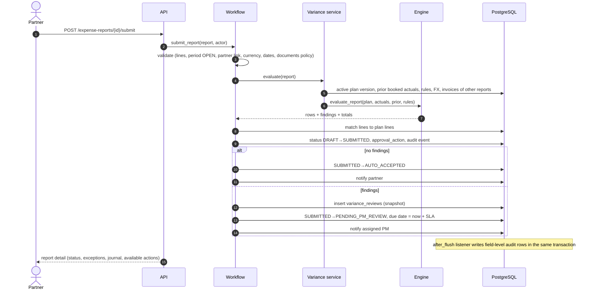
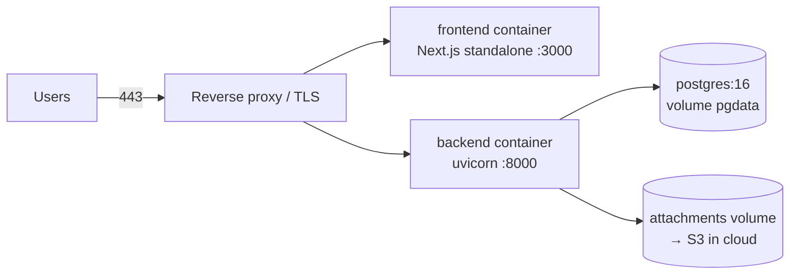

# Architecture

## 1. System overview

### Layers and responsibilities

| Layer | Folder | Responsibility | Depends on |
|---|---|---|---|
| API | `app/api/v1` | HTTP, validation (Pydantic), role guards, pagination, error envelope | services, workflows |
| Workflow | `app/workflows` | Status machine, segregation of duties, approval journal, notifications | services, engine |
| Domain engine | `app/services/variance_engine.py` | Variance maths, tolerance resolution, control findings — **no I/O** | nothing (stdlib) |
| Services | `app/services` | Persistence orchestration, budgets, exports, dashboards, storage, audit | models |
| Models | `app/models` | SQLAlchemy 2.0 mapping, constraints, indexes | — |
| Core | `app/core` | Settings, DB session, security (JWT/bcrypt), enums, errors, dependencies | — |

The engine and the state machine are framework-free on purpose: the financial logic can be unit-tested in milliseconds,
reused in a batch job (e.g. month-end re-evaluation) or moved to another service without touching HTTP or the ORM.

## 2. Data flow — submission

Review steps (`/pm-review`, `/finance-review`) follow the same pattern: state machine check → SoD guards → journal →
exception status update → notification, all in one database transaction.

## 3. Security model

| Concern | Implementation |
|---|---|
| Authentication | Email + password (bcrypt, cost 12) → JWT HS256 access token (8 h, configurable). Swagger *Authorize* uses the OAuth2 password flow. |
| Authorization | Role-based (`require_roles` guard per endpoint) **plus** record-level scoping: partners see their organisation, PMs see the projects they manage, Finance/Auditor see all. Hidden records return 404 (no id probing). |
| Segregation of duties | Enforced in the workflow layer and in the database (see business-rules §7). |
| Data integrity | DECIMAL money, CHECK constraints, FKs with `RESTRICT`, partial unique indexes, line-lock trigger. |
| Auditability | Append-only `audit_logs` and `approval_actions` (DB triggers), request id per call (`X-Request-ID`), actor and IP captured. |
| Input validation | Pydantic schemas (lengths, ranges, decimal places), upload type/size whitelist, SHA-256 of every document, path-traversal-safe storage keys. |
| Secrets | Only via environment variables; `.env.example` files contain placeholders; demo passwords documented as demo-only. |
| Transport | Behind a TLS-terminating reverse proxy in production; CORS restricted to the UI origin. |

Production hardening on the roadmap: refresh tokens in httpOnly cookies, SSO (OIDC/Entra ID), rate limiting on login,
malware scanning of uploads, row-level security in PostgreSQL.

## 4. Deployment model

* **Local / demo:** `docker compose up --build` starts PostgreSQL, the API (runs `alembic upgrade head`, then the
  idempotent seed, then uvicorn) and the UI.
* **Cloud:** the same images run on any container platform (ECS, AKS, Cloud Run). The API is stateless — scale
  horizontally; switch `STORAGE_BACKEND=s3`; use a managed PostgreSQL with PITR backups.
* **CI/CD (GitHub Actions):** lint + unit + API tests → PostgreSQL migration/seed smoke test that also proves the DB
  controls (append-only audit, locked lines) → frontend type-check and build → Docker image build.

## 5. Key design decisions (business ↔ technical)

| Decision | Business reason | Technical consequence |
|---|---|---|
| Rules as data, most-specific-wins, fail-safe | Finance changes policy without a release; donors impose stricter limits on some lines; nothing slips through when no rule exists | `tolerance_rules` table + `resolve_rule()`; missing rule ⇒ review |
| Pure variance engine | The money logic must be explainable and provable to auditors | Deterministic Decimal maths, 16 unit tests, snapshot stored per exception |
| Versioned budgets with maker-checker | Reforecasts are normal in projects but must be traceable and approved | New version per change; one ACTIVE version enforced by DB |
| Re-evaluate on resubmission | An approval must never cover figures that changed after it | Approvals cleared, old exceptions SUPERSEDED |
| Overspend-only default | Approval authorises spend; under-spend is a forecasting topic | `direction` per rule; `BOTH` available |
| DB-level controls in addition to app checks | Admin access to the database must not bypass financial controls | Triggers + constraints in migration; verified in CI |
| Monolith with clear modules | One developer can run and extend it; modules map to future services | Routers/services/workflows separated; engine has no I/O |
