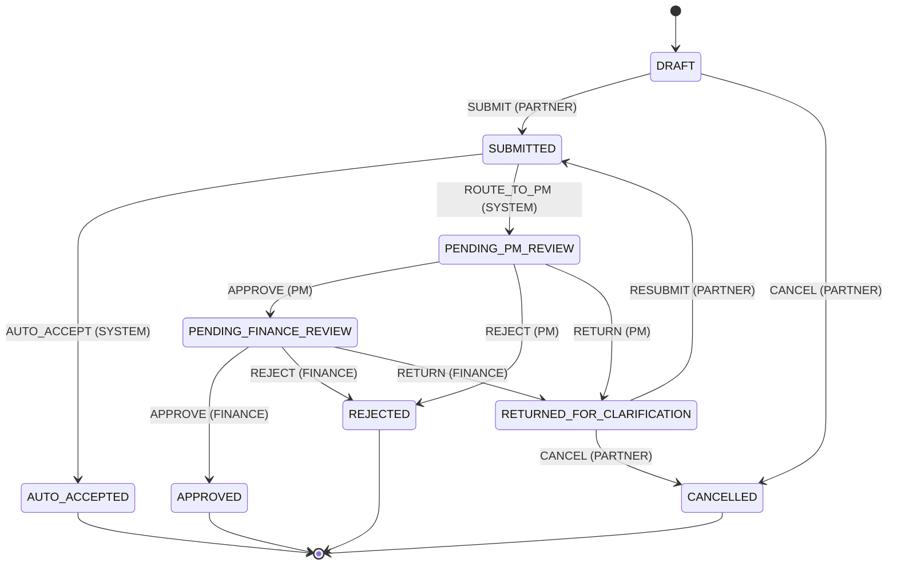

# Business rules

This document is the functional specification of the control logic. Every rule below is
enforced in code; the "Where" column points to the implementation so a reviewer can verify it.

## 1. Concepts

| Term | Meaning |
|---|---|
| **Plan line** | Approved amount for partner × project × fiscal year × month × cost category × GL account (active budget version). |
| **Expense report** | One partner's monthly report for one project and period. Contains expense lines. |
| **Comparison grain** | Cost category + GL account, for the report's month. Several invoices on the same key are summed. |
| **Booked actuals** | Lines of reports in `AUTO_ACCEPTED` or `APPROVED`. Only booked actuals count in YTD and dashboards' "actual". |
| **Exception** (`variance_reviews`) | A control finding raised at submission. Each has type, severity, a calculation snapshot and a lifecycle. |

## 2. Calculations (per comparison key)

| Metric | Formula |
|---|---|
| Planned amount | Plan line of the report month (0 if none) |
| Actual amount | Σ line amounts of this report on the key |
| Absolute variance | Actual − Planned (signed; positive = overspend) |
| Variance % | (Actual − Planned) / Planned × 100, rounded half-up to 0.01. Undefined when Planned = 0 and Actual > 0 |
| YTD planned | Σ plan, months 1..report month |
| YTD actual | Σ booked actuals of other reports, months 1..report month + this report |
| YTD variance | YTD actual − YTD planned |
| Remaining budget | Annual planned − all booked actuals of the year − this report |

All amounts are `NUMERIC(18,2)` in PostgreSQL and `decimal.Decimal` in Python; floats are never used for money.
The API transmits money as decimal strings (`"10450.00"`). *Where:* `app/services/variance_engine.py`.

## 3. Tolerance rules

* Rules are **data, not code** (`tolerance_rules`), maintained by the Finance Lead with a mandatory change reason.
* A key is **within tolerance** when **|variance %| ≤ max %** *and* **|variance| ≤ max amount** (both limits must hold).
  Example default: ≤ 5 % and ≤ USD 500 → auto-accept; > 5 % *or* > USD 500 → review.
* **Direction**: `OVERSPEND_ONLY` (default) tests only actual > plan; `BOTH` also flags under-spend.
  *Design decision:* the approval decision authorises *spending*; under-spend is a burn-rate/forecast signal shown on
  dashboards and handled through reforecasting, so by default it does not block acceptance. Donors that require it can use `BOTH`.
* **Resolution** – most specific active rule wins: project (4) + partner (2) + cost category (1) specificity points,
  then lowest `priority`, then lowest id. Effective-dated (`effective_from`/`effective_to`).
* **Fail-safe** – if no rule applies, the line is treated as *outside* tolerance (manual review), never silently accepted.
* The absolute limit is expressed in the rule currency; report amounts are converted with the latest `exchange_rates`
  row on or before the evaluation date.

## 4. Control checks run at submission

| # | Check | Result | Severity |
|---|---|---|---|
| C1 | Report has ≥ 1 line; partner is an active implementing partner of the project | Submission refused (422) | — |
| C2 | Period is OPEN (setting `require_open_period`) | Submission refused | — |
| C3 | Line currency = report currency; expense date within fiscal year and not after period end | Submission refused | — |
| C4 | An ACTIVE budget version exists | Submission refused (`NO_ACTIVE_PLAN`) | — |
| C5 | Variance outside tolerance (Section 3) | `VARIANCE_OVER_TOLERANCE` | HIGH if > 2× a limit, else MEDIUM |
| C6 | No plan line for the key in the whole fiscal year | `NO_PLAN_LINE` (one per expense line) | HIGH |
| C7 | Same invoice reference (trimmed, case-insensitive) twice in the report or in another live report of the same partner/project | `DUPLICATE_INVOICE` | HIGH |
| C8 | Line without supporting document | `REQUIRE_REVIEW` policy → `MISSING_DOCUMENT`; `BLOCK` policy → submission refused | MEDIUM |
| C9 | Cumulative booked actuals + this report > annual plan | `OVER_ANNUAL_BUDGET`; project flagged over budget on dashboards | HIGH |

**Outcome:** no exception → `AUTO_ACCEPTED`. One or more → `PENDING_PM_REVIEW` with a review due date (SLA setting).
Lines are matched to plan lines (`matched_plan_line_id`) before the status changes.
*Where:* `app/workflows/report_workflow.py::submit_report`.

## 5. Status transition rules

(Generated from code: `python -c "from app.workflows.state_machine import mermaid_diagram; print(mermaid_diagram())"`.)

| From | Action | To | Who | Comment |
|---|---|---|---|---|
| DRAFT | SUBMIT | SUBMITTED → engine | Partner (own org) | optional |
| DRAFT | CANCEL | CANCELLED | Partner | mandatory |
| SUBMITTED | AUTO_ACCEPT | AUTO_ACCEPTED | System | system text |
| SUBMITTED | ROUTE_TO_PM | PENDING_PM_REVIEW | System | system text |
| PENDING_PM_REVIEW | APPROVE | PENDING_FINANCE_REVIEW | Assigned PM | **mandatory** |
| PENDING_PM_REVIEW | REJECT / RETURN | REJECTED / RETURNED | Assigned PM | **mandatory** |
| PENDING_FINANCE_REVIEW | APPROVE | APPROVED | Finance Officer | **mandatory** + checklist |
| PENDING_FINANCE_REVIEW | REJECT / RETURN | REJECTED / RETURNED | Finance Officer | **mandatory** |
| RETURNED_FOR_CLARIFICATION | RESUBMIT | SUBMITTED → engine | Partner | **mandatory** |
| RETURNED_FOR_CLARIFICATION | CANCEL | CANCELLED | Partner | mandatory |

* Terminal statuses: `AUTO_ACCEPTED`, `APPROVED`, `REJECTED`, `CANCELLED`. Any other request returns **409 INVALID_STATUS_TRANSITION**
  listing the allowed actions.
* Lines are editable only in `DRAFT` and `RETURNED_FOR_CLARIFICATION` (API + PostgreSQL trigger `trg_expense_lines_lock`).
* On resubmission, open exceptions become `SUPERSEDED`, PM/Finance approvals are cleared and the engine runs again —
  an approval is never carried over to changed figures.
* One live report per partner/project/period; `CANCELLED` and `REJECTED` reports free the period for a corrected report.

*Where:* `app/workflows/state_machine.py` (single source of truth, unit-tested).

## 6. Approval matrix

| Situation | Partner | Project Manager | Finance Officer | Finance Lead | Auditor |
|---|---|---|---|---|---|
| Report within tolerance | submits | — | — | — | reads |
| Report with exceptions | submits / clarifies | 1st level: business justification & project need | **2nd level, final**: budget availability, accounting treatment, documents | — | reads |
| Budget version | — | reads own projects | creates (maker) | **activates (checker)** | reads |
| Tolerance rules, settings, periods, users | — | — | reads | maintains (with reason) | reads |

Finance approval of an exception requires: a recorded PM approval, a checklist with all three confirmations
(`budget_available`, `accounting_treatment_ok`, `documents_ok`) and a comment.
A database CHECK constraint guarantees an `APPROVED` report has two different approvers.

## 7. Segregation of duties

| Rule | Enforcement |
|---|---|
| Partners cannot approve their own (or any) report | Role guard on review endpoints + `_sod_common` (partner users and report creators/submitters cannot review) |
| PM cannot give the final financial approval | State machine: only `FINANCE_OFFICER` reaches `APPROVED` |
| Finance is the final approver for exceptions | Single transition into `APPROVED`; `ck_report_approved_needs_two_approvers` |
| Four-eyes: PM approver ≠ Finance approver | Service check + DB constraint |
| Only the PM assigned to the project reviews it | `project.project_manager_id == actor` |
| Conflicting role combinations cannot be assigned | `PARTNER`+any internal approver role, `PROJECT_MANAGER`+`FINANCE_OFFICER` refused (403 `SEGREGATION_OF_DUTIES`) |
| Admins cannot change their own roles or deactivate themselves | User service |
| Budget maker ≠ checker | Version activation by a different user (setting `budget_maker_checker`) |
| Administrators have no workflow power | Finance Lead is not in any transition's allowed roles |
| No silent changes to financial data | ORM audit listener on every audited table + append-only `audit_logs` (DB trigger) + locked lines |

## 8. Audit trail

* Automatic: every INSERT/UPDATE/DELETE of an audited entity (reports, lines, attachments, exceptions, budgets,
  rules, settings, users, roles, partners, projects, periods, FX rates) → `audit_logs` with field-level old/new values,
  actor id/email/roles, request id, IP.
* Explicit business events: SUBMIT, RESUBMIT, AUTO_ACCEPT, ROUTE_TO_PM, APPROVE, REJECT, RETURN, CANCEL, ACTIVATE,
  CONFIG_CHANGE (with reason), UPLOAD (with SHA-256), EXPORT, IMPORT, LOGIN, LOGIN_FAILED.
* `approval_actions` is the immutable workflow journal (stage, from → to, comment, Finance checklist).
* `audit_logs` and `approval_actions` reject UPDATE/DELETE at database level.

## 9. Settings (system_settings)

| Key | Default | Effect |
|---|---|---|
| `missing_document_policy` | `REQUIRE_REVIEW` | `BLOCK` refuses submission when a line has no document |
| `pm_review_sla_days` | 3 | Due date of PM review → overdue flag/queue filter |
| `finance_review_sla_days` | 3 | Due date of Finance validation |
| `require_open_period` | true | Submission only for OPEN reporting periods |
| `budget_maker_checker` | true | Version activation by a different user than the creator |
