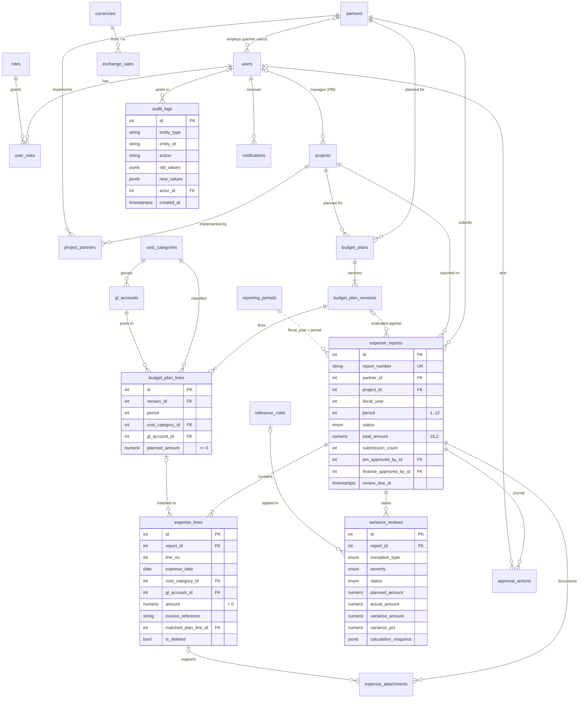

# Data model (ERD)

PostgreSQL 16, normalised to 3NF. Money: `NUMERIC(18,2)`; FX rates `NUMERIC(18,8)`; percentages `NUMERIC(9,4)`.
Enumerations are native PostgreSQL ENUM types. Migration: `backend/alembic/versions/20261123_0001_initial_schema.py`.

## Tables

| Table | Purpose | Key constraints |
|---|---|---|
| `users` | People who log in. Partner users carry `partner_id` (data scoping). Soft delete. | `email` unique |
| `roles` | PARTNER, PROJECT_MANAGER, FINANCE_OFFICER, FINANCE_LEAD, AUDITOR | `code` unique |
| `user_roles` | Many-to-many with `granted_by_id` | unique (user, role) |
| `partners` | Implementing partner organisations. Soft delete. | `code` unique |
| `projects` | Projects with donor, dates, currency and responsible PM. Soft delete. | `code` unique; `end_date >= start_date` |
| `project_partners` | Agreement linking a partner to a project | unique (project, partner) |
| `cost_categories` / `gl_accounts` | Chart of accounts; GL accounts map to one category | unique codes |
| `currencies` / `exchange_rates` | ISO-4217 currencies and dated FX rates | rate > 0; unique (pair, date); from ≠ to |
| `reporting_periods` | Fiscal calendar with deadlines and OPEN/CLOSED status | unique (year, period); period 1..12 |
| `budget_plans` | Plan header: partner × project × fiscal year | unique (partner, project, year) |
| `budget_plan_versions` | Versioned plan; DRAFT → ACTIVE → SUPERSEDED; reason, maker, checker | unique (plan, version_no); **partial unique: one ACTIVE per plan** |
| `budget_plan_lines` | Monthly planned amount per category/GL | unique (version, period, category, GL); amount ≥ 0 |
| `expense_reports` | Monthly report header and workflow state | **partial unique: one live report per partner/project/period**; `APPROVED ⇒ two distinct approvers` |
| `expense_lines` | Expense lines; soft delete; plan match | amount > 0; trigger locks lines outside DRAFT/RETURNED |
| `expense_attachments` | Supporting documents (storage key, SHA-256, size, MIME) | size > 0; storage key unique |
| `variance_reviews` | Exceptions raised by the engine, with calculation snapshot, PM justification, Finance note | indexed by report, status/type |
| `approval_actions` | Immutable workflow journal | append-only trigger |
| `tolerance_rules` | Configurable thresholds with scope, direction, priority, validity | limits ≥ 0; `effective_to >= effective_from` |
| `system_settings` | Key/value configuration (JSONB) | PK key |
| `audit_logs` | Append-only change log with old/new JSONB | append-only trigger; indexes on entity, actor, date |
| `notifications` | In-app notifications | index (user, read_at) |

## Design notes

* **Versioned plans, not edited plans.** A report stores `budget_plan_version_id`, and each exception stores a JSON
  calculation snapshot, so a decision can be explained later even after a reforecast.
* **Soft delete** on master data and expense lines keeps history; reports are never deleted (CANCELLED instead).
* **Partial unique indexes** encode business invariants (one ACTIVE version; one live report per period) in the database.
* **Surrogate integer keys** for simplicity; `report_number` (`ER-2026-00042`) is the business key shown to users.
* Indexes follow the query paths: queue (`status`, `review_due_at`), plan lookup (`version, category, GL`),
  duplicate detection (`invoice_reference`), audit (`entity_type, entity_id`, `created_at`).
