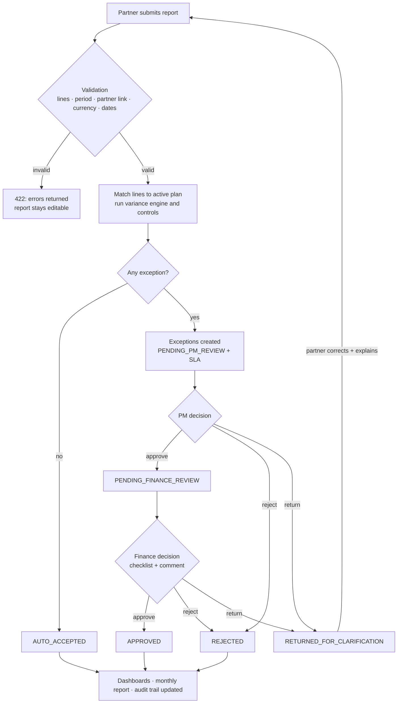

# Project plan

## 1. Concise plan

**Problem.** Organisations that implement projects through external partners receive dozens of monthly expense reports.
Comparing each line to the approved budget in spreadsheets is slow, inconsistent and leaves no reliable trail of who
accepted which overspend and why.

**Goal.** An ERP-style module that checks every report against the approved plan automatically, accepts what is within
policy, and routes only the exceptions through a two-level review (business, then financial) — with complete traceability.

**Success criteria (MVP).**
1. ≥ 70 % of reports in the demo data are accepted without human touch; every exception has a recorded decision with comment.
2. No path exists — in the UI, API or database — to approve an exception without both PM and Finance approval by two different people.
3. Every change to financial data is reproducible from the audit trail (who, when, old → new).
4. A reviewer can run the whole system with one command (`docker compose up --build`).

**Scope.** In: plans and versions, partner reporting, variance engine, rules, workflow, dashboards, exports, audit, RBAC.
Out (roadmap): payments, POs/commitments, accounting integration, SSO, e-mail delivery.

**Approach.** Domain logic first (pure engine + state machine, unit-tested), then persistence and API, then UI.
Database constraints back up every critical application rule.

## 2. MVP feature list

| # | Feature | Acceptance |
|---|---|---|
| F1 | JWT authentication, 5 roles, record-level scoping | Login, `/auth/me`, 403/404 behaviour |
| F2 | Partner, project, partner–project agreements, chart of accounts | CRUD (Finance Lead), soft delete |
| F3 | Budget plans: create, CSV upload, versions, maker-checker activation | One ACTIVE version per plan |
| F4 | Expense reports: draft, lines, documents, submission, cancel | Line lock after submission |
| F5 | Variance engine: plan, actual, variance, %, YTD, remaining | Decimal maths, unit-tested |
| F6 | Configurable tolerance rules (scope, direction, priority, validity) | Most-specific-wins, fail-safe |
| F7 | Controls: duplicate invoice, no plan line, missing document, annual overrun | Exceptions with snapshot |
| F8 | Auto-acceptance | No exception ⇒ AUTO_ACCEPTED |
| F9 | PM review → Finance validation (approve / reject / return, mandatory comments, checklist) | State machine + SoD |
| F10 | Exception queue with SLA and overdue flag | Due dates from settings |
| F11 | Dashboards: KPIs, plan vs actual by month, projects, partners, top variances | Scoped per role |
| F12 | Reports/exports: monthly variance, register, top variances (CSV/XLSX) | Exports audited |
| F13 | Audit trail with old/new values, append-only | DB triggers |
| F14 | Seed data, tests, Docker Compose, CI | One-command start; green CI |

## 3. ERD

See [erd.md](erd.md) — 23 tables (18 required + `budget_plan_lines`, `cost_categories`, `gl_accounts`,
`reporting_periods`, `system_settings`).

## 4. API endpoint list

See [api.md](api.md) — 62 endpoints grouped by Authentication, Users & Roles, Master data, Budget plans,
Expense reports, Variance reviews, Dashboard & reports, Audit trail, Configuration, Notifications.

## 5. Workflow and status transitions



Detailed transition table: [business-rules.md §5](business-rules.md#5-status-transition-rules).

## 6. File / folder structure

```
partner-expense-control-erp/
├── backend/
│   ├── app/
│   │   ├── api/v1/          # routers: auth, users, master_data, budgets, expense_reports, reviews, dashboard, admin
│   │   ├── core/            # config, database, security, enums, errors, deps (RBAC)
│   │   ├── models/          # SQLAlchemy models (identity, master_data, budget, expense, review, system)
│   │   ├── schemas/         # Pydantic request/response models
│   │   ├── services/        # variance_engine (pure), variance_service, budget, report, dashboard, export, audit, storage …
│   │   ├── workflows/       # state_machine (pure), report_workflow (SoD + journal)
│   │   ├── utils/           # pagination & sorting
│   │   ├── seed.py          # demo data through the real workflow
│   │   └── main.py
│   ├── alembic/             # migration incl. DB-level controls (triggers)
│   ├── tests/unit/          # engine + state machine (no DB)
│   ├── tests/integration/   # API tests on SQLite
│   ├── requirements*.txt, pyproject.toml, Dockerfile, .env.example
├── frontend/
│   ├── src/pages/           # 16 screens (Next.js pages router)
│   ├── src/components/      # Layout, ui kit, charts, report panels, review screen
│   ├── src/services/api.ts  # API client
│   ├── src/context/         # AuthContext
│   ├── src/hooks/           # useApi / useAction
│   ├── src/types/           # API types
│   ├── src/utils/, src/styles/
│   ├── package.json, Dockerfile, .env.example
├── docs/                    # architecture, business rules, ERD, API, user stories, this plan
├── .github/workflows/ci.yml
├── docker-compose.yml, README.md, LICENSE
```

## 7. Implementation sequence

| Step | Work | Output / gate |
|---|---|---|
| 1 | Domain model: enums, variance engine, state machine | Unit tests green (pure Python) |
| 2 | Database schema, constraints, migration, DB triggers | `alembic upgrade head` on PostgreSQL |
| 3 | Core: config, JWT, RBAC dependencies, error envelope, audit listener | Login + `/auth/me` |
| 4 | Master data and budget services (versions, maker-checker, CSV import) | Plans activatable |
| 5 | Report services and submission workflow (validation, engine, exceptions) | Auto-accept / route-to-PM tests |
| 6 | Review workflow (PM, Finance, SoD, journal, notifications) | Approval/rejection/return tests |
| 7 | Dashboards, exports, audit API, configuration API | Export + audit tests |
| 8 | Seed through real workflow | Every status present in demo |
| 9 | Frontend: shell, auth, partner flow, review flow, admin, dashboards | Type-check + build |
| 10 | Docker, CI, documentation | `docker compose up` + green pipeline |

Suggested commit structure (Conventional Commits): `feat(engine): …`, `feat(workflow): …`, `feat(api): …`,
`feat(ui): …`, `test: …`, `docs: …`, `ci: …`, `chore: …`.
